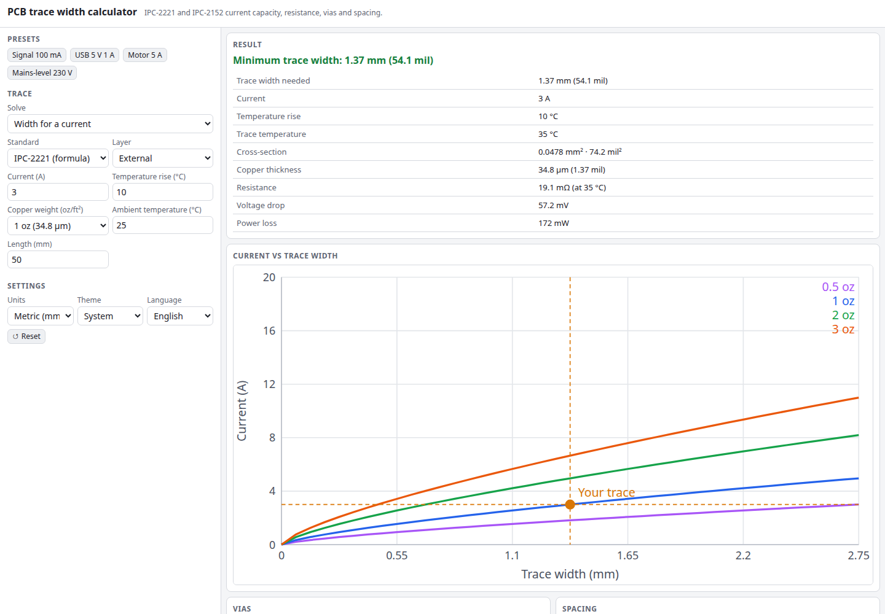

# PCB Trace Width Calculator

How wide must a PCB trace be? Enter a current and an allowed temperature rise and get the minimum trace width from IPC-2221 or an IPC-2152 approximation, for internal or external layers and any copper weight. It also gives resistance, voltage drop and power loss, via current capacity, and the minimum conductor spacing for a voltage. It runs entirely in your browser.

**Try it: [hermes98761234.github.io/pcb-trace-width](https://hermes98761234.github.io/pcb-trace-width/)**

[](https://github.com/hermes98761234/pcb-trace-width/actions/workflows/deploy.yml)



## Features

- **Three ways to solve:** width for a current, maximum current for a width, or the temperature rise for both.
- **IPC-2221 and IPC-2152 (approximation)**, internal and external layers, copper from 0.5 to 4 oz, optional adjacent copper plane.
- **Resistance, voltage drop and power loss** at the real trace temperature (copper's temperature coefficient included).
- **Via current capacity** from the plated barrel, with parallel vias and the number needed for your current.
- **Conductor spacing** for a voltage from IPC-2221 Table 6-1 (internal, external, coated, high altitude), including the per-volt rule above 500 V.
- **Chart** of current vs width for several copper weights with your trace marked.
- Metric or imperial, English or Ukrainian, light or dark theme. Settings persist in the browser. No backend, no tracking.

## How it works

IPC-2221 uses `I = k * dT^0.44 * A^0.725`, with A the cross-section in mil², dT the temperature rise in °C, and k = 0.048 for external and 0.024 for internal layers. The tool inverts it for width and for temperature rise.

IPC-2152 replaced those curves with measured data, which showed internal traces run about as cool as external ones and that a nearby plane helps. The exact IPC-2152 charts are not a single formula, so this tool approximates them with the same law using k = 0.048 for both layers and a 25% allowance for an adjacent plane. Treat it as a guide and verify critical designs.

Resistance uses ρ = 1.724e-8 Ω·m at 20 °C with α = 0.00393 per °C, evaluated at ambient plus the temperature rise. A via barrel is a ring of area π·(D + t)·t, rated with the IPC-2221 external curve.

## Quick start

You need [Node.js](https://nodejs.org/) 22.

```bash
git clone https://github.com/hermes98761234/pcb-trace-width.git
cd pcb-trace-width
npm install
npm run dev       # http://localhost:5173
npm test          # formula, spacing and i18n tests
npm run build     # static site in dist/
```

## License

MIT
